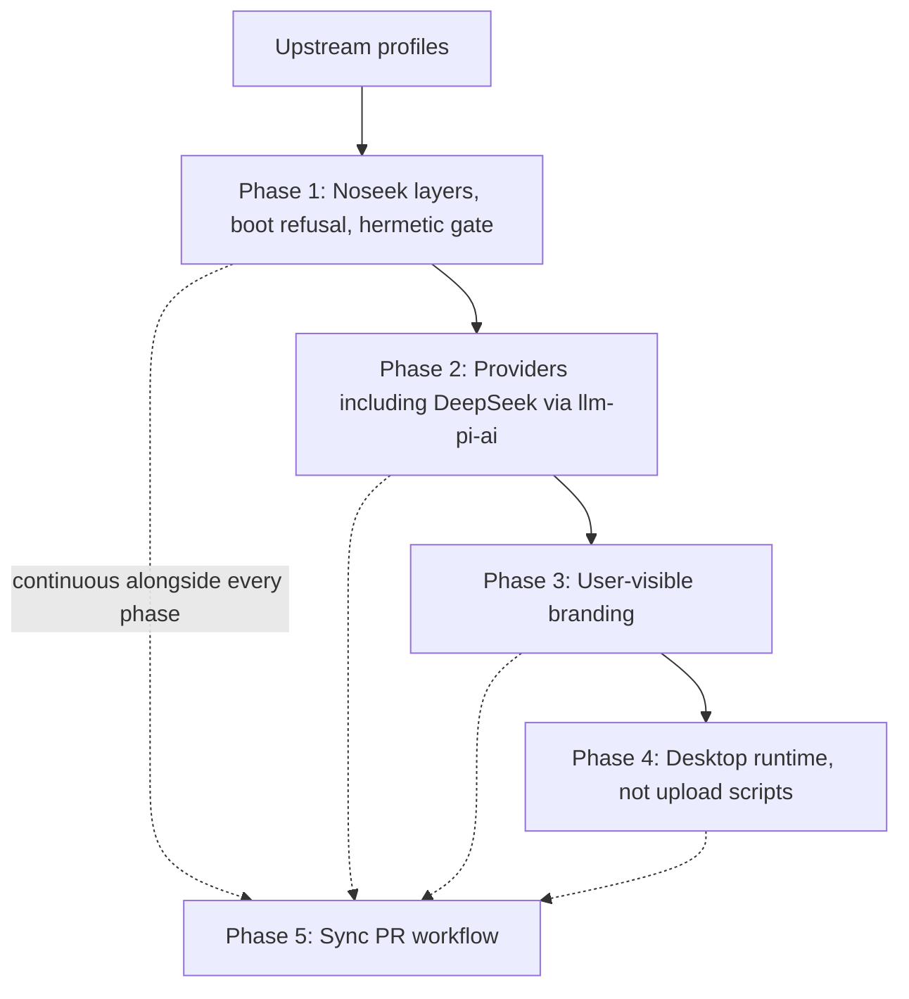

# Noseek Harness: Whitelabel and Telemetry Elimination Plan

> **Vision:** A telemetry-free, vendor-neutral distribution of DeepSeek Harness — the role Chromium plays for Chrome. Guarantees are invariants of every boot, not defaults a later patch can undo.

> **Status: Phases 1–5 Complete.** All quarantine layers, boot refusal checks, `audit:privacy` and `test:hermetic` gates, provider picker notices, user-visible branding replacements, desktop runtime isolation, and upstream sync automation have landed and passed verification. The base is upstream tag `dsh-v0.2.1-alpha.1`; [CHANGELOG.md](CHANGELOG.md) records each later merge.

Related Noseek files: [AGENTS.md](AGENTS.md) (agent rules for this fork), [DELTA.md](DELTA.md) (every upstream file Noseek changes), [CHANGELOG.md](CHANGELOG.md) (per-merge log), [check-delta.sh](check-delta.sh) (ledger gate), and the [upstream sync skill](../.agents/skills/noseek-upstream-sync/SKILL.md).

---

## 1. Executive Summary

`deepseek-harness` (`dsh`) is an open-source, plugin-driven coding agent framework on the [Cordis](https://cordis.chat) microkernel. Shipped profiles mount DeepSeek branding, DeepSeek Platform auth, telemetry, two request-body extensions that attach the session transcript and the plugin inventory to official LLM calls, and automatic probes of mainland-China mirrors.

Noseek Harness will:

1. **Never contact DeepSeek or Chinese infrastructure on its own.** No telemetry, account, updater, feedback-form, or mirror traffic. Blocked hosts are listed in §5.2.
2. **Drop telemetry, transcript upload, plugin-inventory upload, and `x-deepseek-harness-*` headers** by not mounting the plugins and adapter that send them.
3. **Offer DeepSeek as an ordinary bring-your-own-key provider**, equal to OpenAI, Anthropic, or OpenRouter. It runs through the generic `llm-pi-ai` `deepseek` provider, never through the `deepseek-official` route. It is never the default; `api.deepseek.com` is contacted only after the user selects DeepSeek and supplies a key.
4. **Replace user-visible branding** (window title, sidebar, hero, desktop shell, system-prompt opener, `User-Agent`) without renaming the `@deepseek-ai/dsh-*` package scope.
5. **Track upstream release tags** (`dsh-v*`) by merging, and block a merge that fails the privacy gates. Do not rebase `master`.

### Privacy boundary

Noseek guarantees that a shipped profile (`web`, `desktop`, `headless`, `sdk`, `acp`, `sdk-minimal`) with its default configuration makes no network request until the user configures a provider, and never contacts a blocked host (§5.2) even when user configuration names one.

Noseek does not guarantee that no data leaves the machine. The provider the user selects — OpenAI, Anthropic, OpenRouter, DeepSeek, or Ollama on another host — receives prompts, code, and file contents. Air-gapped use means a local model.

### China-hosted provider notice

The provider catalog that `llm-pi-ai` installs from `@earendil-works/pi-ai` includes endpoints operated in mainland China or by Chinese companies, for example `api.deepseek.com`, `*.cn-beijing.maas.aliyuncs.com` (Alibaba Cloud), `open.bigmodel.cn` (Zhipu), `api.moonshot.cn` (Moonshot), `api.minimaxi.com` (MiniMax), and `token-plan-cn.xiaomimimo.com` (Xiaomi). Noseek keeps them selectable and never selects one by default. Choosing one sends that provider your prompts and code under its own jurisdiction and data policy. The README carries the same notice for users; Phase 2 surfaces it in the provider picker.

### Product decision: DeepSeek through `llm-pi-ai`, not `llm-deepseek`

`llm-deepseek` (route `deepseek-official`) is the adapter that sends `x-deepseek-harness-*` headers, writes `$DSH_HOME/.anonymous-user-id`, and carries the `dsh_session_log` and `dsh_plugin_packages` body extensions. The `llm-pi-ai` `deepseek` provider sends a standard request with the user's key, the same way it talks to every other catalog provider. Noseek unmounts `llm-deepseek` and does not edit `packages/llm/llm-deepseek/src/adapter.ts` to delete headers. Phase 2 records any DeepSeek feature that only `llm-deepseek` implements.

---

## 2. Inventory: Tracking, Telemetry, and China Calls

§2.1–§2.3 attach to every request through the `deepseek-official` route. §2.4–§2.7 are product surfaces that call DeepSeek or Chinese infrastructure. §2.8 lists defaults that select those routes. §2.10–§2.13 are automatic China egress or fork-operation hazards outside the original DeepSeek inventory.

### 2.1. Session transcript upload (`dsh_session_log`) — always on

* **Package:** [`@deepseek-ai/dsh-session-log-deepseek`](../packages/session/session-log-deepseek)
* **Mounted in:** [`packages/bundle/base/cordis.patch.yml`](../packages/bundle/base/cordis.patch.yml) and, separately, [`packages/bundle/sdk-minimal/cordis.patch.yml`](../packages/bundle/sdk-minimal/cordis.patch.yml). `sdk-minimal` does not layer on base. A patch that only covers base misses it.
* **Mechanism:** On each official LLM request, serializes the session transcript (prompts, tool calls, file reads, terminal output, up to 8 MiB) into `dsh_session_log` on the request body.
* **Destination:** `https://api.deepseek.com`, through the `deepseek-official` route.
* **Risk:** **Critical.** Disable the row.

### 2.2. Plugin inventory upload (`dsh_plugin_packages`) — always on

* **Package:** [`@deepseek-ai/dsh-plugin-package-inventory-deepseek`](../packages/llm/plugin-package-inventory-deepseek)
* **Mounted in:** base and `sdk-minimal`, same split as 2.1.
* **Mechanism:** Adds `dsh_plugin_packages` (package names and versions) to each official LLM request.
* **Risk:** **High.** Disable the row.

### 2.3. Per-request tracking headers — `deepseek-official` route only

* **Package:** [`@deepseek-ai/dsh-llm-deepseek`](../packages/llm/llm-deepseek)
* **Files:** [`adapter.ts`](../packages/llm/llm-deepseek/src/adapter.ts) sends the headers; [`host.ts`](../packages/llm/llm-deepseek/src/host.ts) calls `getOrCreateAnonymousUserId()` on first use, which writes `$DSH_HOME/.anonymous-user-id`.
* **Headers:** `x-deepseek-harness-user-id`, `x-deepseek-harness-session-id`, `x-deepseek-harness-compact`.
* **Risk:** **High** while the row is mounted. **None** once it is disabled; DeepSeek users go through `llm-pi-ai` instead (§1).

### 2.4. OpenTelemetry — feedback-triggered, not every turn

* **Packages:** `@deepseek-ai/dsh-otel`, `@deepseek-ai/dsh-session-telemetry-otel`, `@deepseek-ai/dsh-host-product-telemetry-otel`
* **Default endpoint:** `https://dsh-otel-collector.deepseeksvc.com/v1/logs` in [`packages/bundle/base/cordis.patch.yml`](../packages/bundle/base/cordis.patch.yml) and as the schema default in [`packages/host/product-telemetry-otel/src/index.ts`](../packages/host/product-telemetry-otel/src/index.ts).
* **Default mode:** `FEEDBACK_ONLY` (`DSH_TELEMETRY_MODE`). Ordinary turns do not export. Explicit feedback can upload a session-log prefix to `deepseeksvc.com`.
* **Existing switch:** `DSH_TELEMETRY_DISABLED` (any non-empty value) appends `{ id: session-telemetry-otel, disabled: true }` **after** user and home patches. See `resolveTelemetryPatch` in [`packages/boot/app-boot/src/profile-context.ts`](../packages/boot/app-boot/src/profile-context.ts). It does **not** disable `session-log-deepseek`, `plugin-package-inventory-deepseek`, `otel`, `product-analytics`, or `desktop-product-telemetry`.
* **Local feedback:** `command-feedback` records `/feedback` as a local session event and creates `.anonymous-user-id` to print it. With the OTel rows disabled, neither leaves the machine. The row stays mounted.
* **Risk:** **High** on the feedback path. Unmount the OTel rows.

### 2.5. Client product analytics and device info

* **Packages:** `@deepseek-ai/dsh-client-product-analytics`, desktop welcome/device IPC.
* **Mounted in:** [`packages/bundle/web-app/cordis.patch.yml`](../packages/bundle/web-app/cordis.patch.yml). `product-analytics` and `desktop-product-telemetry` are disabled unless the profile name is `desktop`.
* **Data:** UI events, OS/screen/locale, and (desktop) CPU model and RAM via `apps/desktop/src/device-info.ts`.
* **Risk:** **High** on the desktop profile. Off on other profiles only because of that `disabled` expression — a renamed or copied profile can flip it. Force-disable by id.

### 2.6. DeepSeek Platform account, Feishu contact form

* **Account packages:** `dsh-deepseek-account-platform` (row id `deepseek-account`), `dsh-client-ui-settings-account`, `dsh-api-account-controller`.
* **Endpoints:** `platform.deepseek.com`, auth and billing paths on `api.deepseek.com`. Desktop `platform-view.ts` loads those pages in a `WebContentsView`.
* **Feishu form default** is the schema default in [`packages/client/ui-settings-account/src/contact-config.ts`](../packages/client/ui-settings-account/src/contact-config.ts) (`trtgsjkv6r.feishu.cn`). Unmounting the account UI removes the link. Do not grep the schema default out of upstream tests.
* **Account-token search:** `web-search-deepseek` sends `x-dsh-auth-token` when an account token resolves. With `deepseek-account` disabled, only its API-key mode remains.

### 2.7. Desktop updater and mandatory policy

* **Runtime:** packaged apps embed an update origin and a policy origin. Production update origin is `https://download.deepseek.com` ([`desktop-auto-update-environment.mjs`](../apps/desktop/scripts/desktop-auto-update-environment.mjs)). Test policy authentication is `feishu-test` ([`desktop-policy-environment.mjs`](../apps/desktop/scripts/desktop-policy-environment.mjs)). `main.ts` starts `DesktopPolicyTestAuth` when the embedded policy says `feishu-test`. `update-coordinator.ts` drives `electron-updater`.
* **Operator scripts, not the running app:** `desktop-cos.ts`, `desktop-upload-run.ts`, `cos-operation.ts`, `installed-update-cos.ts`. They hardcode `ap-beijing` and Tencent COS. Noseek releases must not run them. Rewriting them to silence `grep` rewrites their tests and does not fix privacy.
* **Risk:** **High** for a packaged desktop build that still embeds those origins. **None** for upload scripts that the app never executes.

### 2.8. Default routes that Phase 1 must replace

These are why disabling the telemetry plugins is not enough.

| Row | Where | What it calls |
|---|---|---|
| `agent-default-model` | base: `provider: deepseek-official`, `model: deepseek-flash` | `api.deepseek.com` through `llm-deepseek` on the first turn if a key is present |
| `acp` | [`acp-app`](../packages/bundle/acp-app/cordis.patch.yml): `provider: deepseek-official`, `model: deepseek-v4-flash` | Same |
| `llm-deepseek` | base and `sdk-minimal` | DeepSeek Messages API. Headers and body extensions attach here |
| `llm-deepseek-account` | base | Account-token inference |
| `web` | base `searchProvider: deepseek-official` | `api.deepseek.com` when the model calls `web_search` |

Saved settings under the harness home can select `deepseek-official` again. Sharing `~/.dsh` with an upstream install keeps that selection, the anonymous id file, and platform tokens.

### 2.9. Branding that leaves the machine

Not Phase 1. Still user-visible on every provider:

* [`packages/llm/llm/src/attribution.ts`](../packages/llm/llm/src/attribution.ts) — `User-Agent: deepseek-harness/<version> (+https://github.com/deepseek-ai/deepseek-harness)` on provider requests. `attributionHeaders(identity)` already accepts another identity; callers pass none, so the default applies. One change to `APP_IDENTITY`, not an edit per adapter.
* [`packages/core/system-prompt/src/index.ts`](../packages/core/system-prompt/src/index.ts) — `You are an AI agent powered by DeepSeek Harness.` when `includeHarnessIdentity` is true (the default). `sdk-minimal` already sets it false. A patch that sets the flag replaces the row's whole `config`, so it must restate that mode's `personaPrefix` / `personaSuffix` or it wipes them.
* [`packages/skill/skill-badge`](../packages/skill/skill-badge) — model-facing "powered by dsh" skill. The base row is already `disabled: true`; the quarantine patch restates the disable. Do not rewrite the package.

### 2.10. Plugin-manager registries — automatic China egress

* **Install fallback:** [`packages/boot/plugin-manager/src/index.ts`](../packages/boot/plugin-manager/src/index.ts) defaults `fallbackRegistries` to `[https://registry.npmmirror.com/]` (Alibaba-operated mainland mirror). After a network, timeout, not-found, or no-matching-version failure against the primary registry, installs retry there. `tool-plugin-manager` is mounted in base, so a model tool call can start an install.
* **Speed probe:** [`packages/client/ui-plugin-manager/src/index.ts`](../packages/client/ui-plugin-manager/src/index.ts) pings `registry.npmjs.org` and `registry.npmmirror.com` in parallel when `registryProbeEnabled` is true.
* **Decision:** plugin installs from the npm registry stay supported. The Noseek defaults layer (§5.2) sets `fallbackRegistries: []` and `registryProbeEnabled: false`. A user may still configure a mirror explicitly.
* **Residual risk:** an installed `@deepseek-ai/dsh-*` package comes from upstream's npm releases, not from this fork's audited tree. The final quarantine patch still disables the denylisted row ids if such a package mounts them; a new row id from an installed package is outside the gate and is the user's install decision.

### 2.11. Voice model download origins

* **Package:** [`speech-to-text-sensevoice`](../packages/experimental/speech-to-text-sensevoice/src/config.ts) (experimental, shipped through `voice-input-bundle`).
* **Default:** `modelOrigins` is `['https://huggingface.co', 'https://hf-mirror.com']`; before each download the Host sends concurrent HEAD probes to both.
* **Decision:** the Noseek defaults layer sets `modelOrigins: ['https://huggingface.co']`. A user may add the mirror explicitly.

### 2.12. China-hosted LLM providers in the catalog

See the notice in §1. Selectable, never default, no automatic request. Phase 2 checks that no catalog code path probes provider endpoints the user has not configured.

### 2.13. Upstream GitHub workflows

`.github/workflows/` carries upstream release, publish, docs-deploy, preview, approval, and issue-bot workflows (`release*.yml`, `docs-pages.yml`, `build-preview-cloudflare.yml`, `weighted-approval*.yml`, `issue-*.yml`). On this fork they fail for missing secrets or run upstream automation. Phase 1 guards each job that should not run here with `if: github.repository == 'deepseek-ai/deepseek-harness'` (one line per job, recorded in [DELTA.md](DELTA.md)) and keeps CI that validates code.

### 2.14. Unaudited areas

`python/` (the Python SDK makes HTTP calls in `python/sdk/src/deepseek_harness/client.py`), `native/` (`@deepseek-ai/node-addon-system`), and `vendor/` (Cordis) are in scope for the hermetic test and the sync review but have not been read for egress. Phase 1 records what each contacts.

---

## 3. Branding Inventory

| Surface | File | Notes |
|---|---|---|
| Document title | `scripts/client-build-environment.ts`, `apps/web/vite.config.ts` | Build-time. Slot plugins cannot change it |
| Sidebar mark | `packages/client/ui-brand-official`, fallback in `ui-sidebar` `SidebarRoot.tsx` | Disable `ui-brand-official` (row in `web-app`). Fallback fish still renders if the slot is empty |
| Empty hero | `ui-conversation` `EmptyHero.tsx` | Hardcoded fish SVG |
| Wordmark primitives | `ui-primitives` `FishLogo.tsx`, `BrandWordmark.tsx` | Leave the components. Stop mounting them |
| Desktop copy | `apps/desktop/src/locale.ts` | Menu, about, quit, welcome. Locale-owned; do not hardcode replacement strings in components |
| Desktop about / protocol | `apps/desktop/src/main.ts` | `applicationName`, `dsh` protocol |
| Packaged app name | `apps/desktop/scripts/package-target.ts`, `smoke-packaged-runtime.ts` | `DeepSeek Harness.app` / `.exe` |
| Web prompt | `packages/bundle/web-app` | "DeepSeek Harness Web GUI" |
| Repository README | `README.md`, `README.zh.md` | Upstream-owned and left unchanged; GitHub shows the Noseek README from `.github/README.md` |

### 3.1. Package scope

Keep `@deepseek-ai/dsh-*`. A new brand plugin, if a slot occupant is required, is `@deepseek-ai/dsh-client-ui-brand-noseek`. Do not introduce `@noseek/*`. Workspace hygiene and client package rules require the existing scope. Chromium does not rename Google's internal namespaces. Noseek does not publish these packages to npm.

A `noseek` command may only `exec` `dsh` with the Noseek home. It must not boot a second runtime. Only `dsh` profiles launch apps.

### 3.2. License and trademark

Keep `LICENSE` (MIT, Copyright DeepSeek) and `THIRD_PARTY_NOTICES.md` unchanged; MIT requires the notice. [BRAND_GUIDELINES.md](../BRAND_GUIDELINES.md) permits describing the project as built on DeepSeek Harness and forbids implying endorsement. The Noseek README states that Noseek is not affiliated with or endorsed by DeepSeek.

---

## 4. What Composition Can and Cannot Do

Patch order, from [`apps/cli/src/profile-boot.ts`](../apps/cli/src/profile-boot.ts) and [`readProfilePatches`](../packages/boot/app-boot/src/profile-context.ts):

1. Bundles in the profile's `dsh.profile.bundles`, resolved from the `dsh` installation first.
2. The profile's `cordis.patch.yml`.
3. `$DSH_HOME/cordis.patch.yml` (beats the profile file).
4. `--patch` overlays.
5. The telemetry switch, appended last, and only for `session-telemetry-otel`.

A later layer wins per row. A patch replaces that row's whole `config`. `{ id, disabled: true }` is the pattern `resolveTelemetryPatch` already uses.

Profiles are copied once into `$DSH_HOME/profiles/<name>` from `PROFILE_TEMPLATES` in [`packages/boot/app-boot/src/profile.ts`](../packages/boot/app-boot/src/profile.ts). A new bundle added only to the template does not attach to an already-initialized profile, so Noseek layers are inserted by `readProfilePatches`, not by templates. Desktop, HMR, and the plugin manager all call `readProfilePatches`.

### 4.1. Composition is enough for

* Disabling the rows in §2, including `sdk-minimal`, if the disable is applied **after** every user layer.
* Replacing upstream defaults (model route, search provider, registries, voice origins) in a layer applied **before** the profile and user layers, so user choices still win.
* Setting `includeHarnessIdentity: false` without editing `system-prompt` source, if the patch restates the mode persona fields.
* Leaving `ui-brand-official` unmounted.
* Setting `DSH_TELEMETRY_DISABLED`. Necessary, not sufficient.

### 4.2. Composition is not enough for

* A user patch, home patch, or plugin-manager toggle that re-enables a denylisted row **unless** the final layer disables it again and boot refuses when the composed tree still has it enabled.
* Hardcoded fish fallbacks, document title, desktop locale strings, and the packaged app file name.
* `APP_IDENTITY`, until callers pass an identity or the default constant changes.
* The desktop main process, which reads embedded update/policy metadata and does not go through Cordis for those HTTP calls.
* The plugin manager writing `disabled: false` back into the profile file. The next `readProfilePatches` must override that again. The toggle should fail with an error, not look enabled.

### 4.3. Do not do

* Strip headers in `adapter.ts`. Unmount the adapter.
* Nullify the OTel schema default in upstream source so that `grep` is clean. Disable the rows.
* Require `grep -r deepseek.com` over `apps/desktop` or `packages/` to return zero. Upstream tests and operator scripts contain those hosts on purpose.
* Maintain an allowlist of every plugin. Each new upstream tool would fail the sync for no privacy reason.
* Rely on an in-process `fetch` hook as the privacy proof. Child processes, `node:http`, WebSockets, native code, and the Electron main process do not pass through it. Use the hermetic network test (§5.3).
* Override user provider or search choices in the final layer. The final layer only disables denylisted rows.
* Push sync merges straight to `master`.

---

## 5. Enforcement

### 5.1. Home split

Default home directory becomes `~/.noseek` (`DSH_HOME_DIR_NAME` in [`packages/util/home-paths/src/index.ts`](../packages/util/home-paths/src/index.ts)). `DSH_HOME` still overrides. Desktop uses `resolveDshHome()`, so one constant covers it.

Do not read `~/.dsh`. That directory holds upstream profiles, saved `deepseek-official` settings, credentials, and `.anonymous-user-id`.

### 5.2. Two Noseek layers

All Noseek layer logic lives in a new Noseek-owned module (for example `packages/boot/noseek-policy/`, still under the `@deepseek-ai/dsh-*` scope). `profile-context.ts` gains only the calls that insert the two layers; each call is a [DELTA.md](DELTA.md) row.

**Defaults layer** — inserted after the bundles and before the profile's `cordis.patch.yml`, so the profile, home patch, `--patch`, and Settings UI can change every value:

* `agent-default-model` and `acp` — no provider selected. A turn without a configured provider fails with an error that says a provider is required. The privacy test injects a loopback model. Do not require Ollama in CI.
* `web` — no `searchProvider`; `fetchProvider: http` stays. A user-initiated `web_fetch` to any URL is the user's action.
* `plugin-manager` — `fallbackRegistries: []`; `ui-plugin-manager` — `registryProbeEnabled: false`.
* `speech-to-text-sensevoice` — `modelOrigins: ['https://huggingface.co']`.
* Each row's whole `config` is restated, because a patch replaces it.

**Final quarantine layer** — appended after the telemetry switch, on every boot and every HMR reload. It forces `disabled: true` on:

* `session-log-deepseek`
* `plugin-package-inventory-deepseek`
* `session-telemetry-otel`
* `otel`
* `desktop-product-telemetry`
* `product-analytics`
* `deepseek-account`
* `account-controller` (its remotes call Platform through `deepseekAccount`)
* `ui-settings-account`
* `llm-deepseek` (route `deepseek-official`)
* `llm-deepseek-account`
* `skill-badge` (already disabled in base; restated so a later layer cannot re-enable it)

`web-search-deepseek` and the `llm-pi-ai` `deepseek` provider are not quarantined; they are user-selectable like every other provider.

**Boot refusal.** After composition, boot fails fast with a named error (row id plus the offending host or value; non-zero exit; one log line per violation) if a quarantined row is enabled, any resolved config selects the provider id `deepseek-official`, or any resolved config value contains a blocked host. Plugin-manager enable of a quarantined id fails with the same error. A row that is absent is fine.

**Blocked hosts** — never contacted, even when user configuration names them. Matched as registrable suffixes on resolved config and on observed connections:

* `deepseeksvc.com`
* `feishu.cn`
* `myqcloud.com`
* `deepseek.com`, **except** the exact host `api.deepseek.com`, which is reachable only as the base URL of a user-selected provider or search route

Positive cases: `dsh-otel-collector.deepseeksvc.com`, `platform.deepseek.com`, `download.deepseek.com`, `download-test.deepseek.com`, `cdn.deepseek.com`, `api-docs.deepseek.com`, `trtgsjkv6r.feishu.cn`, `x.cos.ap-beijing.myqcloud.com`. Negative cases: `api.deepseek.com`, `deepseek.com.example.org`, `notdeepseek.com`. The matcher's tests list both sets.

**Not-default hosts** — absent from Noseek defaults, allowed when the user configures them: `registry.npmmirror.com`, `hf-mirror.com`, `api.deepseek.com`, and the China-hosted catalog endpoints in §1. The hermetic test catches any of them reached by default configuration, because default configuration reaches nothing.

### 5.3. Privacy gate

`pnpm run audit:privacy` (Phase 1 creates it) composes every shipped profile — `acp`, `web`, `desktop`, `headless`, `sdk`, and `sdk-minimal` (templates in `PROFILE_TEMPLATES`; `desktop` runs over the web-app bundles with the desktop profile name) — with a home patch and a `--patch` that try to re-enable `session-log-deepseek`, select `deepseek-official`, and set the OTel endpoint. Each attempt must leave the row disabled or fail the boot. It also asserts that a home patch selecting the `llm-pi-ai` `deepseek` provider composes without error.

**Hermetic network test** (Linux CI). Run inside a container or network namespace with no route except loopback (`docker run --network none` or `unshare -n`):

* A stub DNS server on loopback, named in `/etc/resolv.conf`, logs every query.
* The harness runs under `strace -f -e trace=connect`, which records every connect from the harness and all child processes (MCP servers, LSP servers, shell commands, browser drivers).
* Boot each profile with default configuration plus a loopback model, run a turn that would have searched, open the feedback dialog, and open the plugin manager.

The test passes when:

* no DNS query is logged for a non-loopback name
* no `connect` targets a non-loopback address
* loopback-model request bodies contain no `dsh_session_log` or `dsh_plugin_packages`
* loopback-model request headers contain no `x-deepseek-harness-*`
* `~/.noseek/.anonymous-user-id` is not created by boot, a turn, or the dialog

The test needs no host list and no fetch seam: any new egress fails it, whatever its host, transport, or process. The blocked-host matcher covers configuration that names a host the hermetic test cannot reach.

Upstream unit tests stay. They may mention `api.deepseek.com`. Noseek release CI does not need `DEEPSEEK_API_KEY`. Upstream e2e workflows that call the official API are engine tests, not the privacy gate.

### 5.4. Upstream sync

Follow the [noseek-upstream-sync skill](../.agents/skills/noseek-upstream-sync/SKILL.md). Summary:

* Merge the next upstream release tag (`dsh-v*`) on a branch `sync/<tag>`. Open a PR. Do not rebase published `master`. Do not push the merge to `master` from automation.
* Review the upstream diff for new hosts, new network call sites, new rows and profiles, dependency changes, and new workflows before merging.
* Resolve conflicts with [DELTA.md](DELTA.md) as the source of truth; run [check-delta.sh](check-delta.sh), `audit:privacy`, and the hermetic test; add a [CHANGELOG.md](CHANGELOG.md) entry.
* There is no conflict-count threshold. One conflict in `profile-context.ts` can drop the quarantine. A clean merge that adds a new host is the case the gate exists for. If the gate fails, do not ship, and do not weaken the gate to pass.

Cadence is evaluation of each upstream release tag. Lag is acceptable. A red gate is not.

### 5.5. Fork delta policy

* Prefer new files over edits to upstream files. New files never conflict.
* An unavoidable upstream edit is the smallest hook that calls Noseek-owned code, and gets a [DELTA.md](DELTA.md) row: path, reason, how to re-apply after a conflict, and the test that covers it.
* `noseek/check-delta.sh` fails when an upstream file differs from the base tag without a ledger row, or a ledger row names a file that no longer differs.
* Noseek prose lives in `noseek/` and `.github/README.md`. Do not edit `README.md`, `README.zh.md`, or other upstream docs for Noseek purposes.

---

## 6. Phases

### Phase 1: Noseek layers and privacy gate

**Goal:** Every shipped profile, including one already copied and one with a hostile home patch, makes no automatic network request and never reaches a blocked host. `deepseek-official` is not a route.

**Actions:**

1. Default home `~/.noseek`.
2. Defaults layer and final quarantine layer (§5.2) in a Noseek-owned module, including `sdk-minimal`; boot refusal.
3. Launcher sets `DSH_TELEMETRY_DISABLED` as a backstop, not as the mechanism.
4. `audit:privacy` and the hermetic network test (§5.3).
5. Guard upstream-only workflows (§2.13).
6. Record what `python/`, `native/`, and `vendor/` contact (§2.14).

**Not in this phase:** adapter header edits, OTel schema edits, fish SVG replacement, provider picker changes, desktop icon swap.

**Done when:**

- [x] Re-enabling a quarantined row from the home patch or `--patch` does not stick.
- [x] Hermetic test: no non-loopback DNS query or connect; no transcript field, inventory field, or `x-deepseek-harness-*` header.
- [x] Opening the feedback dialog and the plugin manager writes no outbound request.
- [x] Anonymous id file is not created by boot or a turn.
- [x] `sdk-minimal` is in the audited set.
- [x] The home-directory change and the removed `deepseek-official` route are recorded in an upgrade guide.
- [x] Every upstream file edit has a [DELTA.md](DELTA.md) row and `check-delta.sh` passes.
- [x] Upstream unit tests that mention `deepseek.com` still pass.

### Phase 2: Providers

**Goal:** A fresh `~/.noseek` can run a turn with any supported provider, DeepSeek included, and no provider is preselected.

**Actions:**

1. Spike first: prove `llm-pi-ai` covers Ollama, vLLM, llama.cpp, OpenAI, Anthropic, OpenRouter, and DeepSeek, and record the gaps. For DeepSeek, list every feature that only `llm-deepseek` implements (thinking format, context caching, compaction) and decide whether each matters. Keys stay in the existing local credential file.
2. The provider picker lists DeepSeek alongside the others with no special placement. It shows the China-hosted provider notice (§1) through locale dictionaries (English and Chinese), next to the providers it covers.
3. If the user has no provider, the turn fails with that fact. It does not fall through to any default.
4. A saved setting that names `deepseek-official` fails with an error that names the `deepseek` provider as the replacement.
5. Confirm that no catalog code path probes endpoints the user has not configured.

**Done when:**

- [x] Fresh home, no API keys: no outbound request; the UI says a provider is required.
- [x] Loopback or a recorded fixture completes a turn through the `llm-pi-ai` `deepseek` provider with no `x-deepseek-harness-*` header and no `dsh_session_log` or `dsh_plugin_packages` field.
- [x] A settings file that still names `deepseek-official` does not mount `llm-deepseek`.
- [x] The provider picker shows the China-hosted provider notice.

### Phase 3: User-visible branding

**Goal:** Screens, prompts, and `User-Agent` do not say DeepSeek Harness. Upstream tests that pin the old identity are updated only where the Noseek profile is what they boot.

**Actions:**

1. Disable `ui-brand-official`. Replace the fish fallback in `SidebarRoot.tsx` and `EmptyHero.tsx` only because empty slots still render them.
2. Title fallback in the Vite / client build environment.
3. `includeHarnessIdentity: false` via the defaults layer, restating each mode's persona fields, plus a Noseek opener. Do not edit the identity string in `system-prompt/src/index.ts` (that rewrites the snapshot tree).
4. Change `APP_IDENTITY` in `attribution.ts` so the default `User-Agent` is Noseek's. Update `attribution.spec.ts`. Do not thread a new argument through every adapter.
5. Desktop locale strings in `apps/desktop/src/locale.ts` (locale dictionaries, not hardcoded JSX).

**Done when:**

- [x] Noseek web and desktop screens show no fish mark and no "DeepSeek Harness" title.
- [x] A Noseek turn's system prompt and `User-Agent` do not contain `DeepSeek Harness` or `deepseek-ai/deepseek-harness`.
- [x] Upstream snapshots that boot the unmodified identity are unchanged, or explicitly regenerated because the profile they boot is now Noseek.

### Phase 4: Desktop runtime

**Goal:** The running Electron app does not contact blocked hosts. Operator upload scripts may still mention them.

**Actions:**

1. Noseek packaging embeds no update origin and no mandatory-policy origin. `main.ts` must not construct `DesktopPolicyTestAuth` or load `platform-view` against `platform.deepseek.com` in that build.
2. Do not rewrite `desktop-cos.ts` or its tests to delete `ap-beijing`. Do not run those upload commands in Noseek release.
3. About panel and `applicationName` follow Phase 3 copy. App id `com.noseek.harness` and icon replacement are packaging metadata.
4. `device-info` may stay for a local about screen. No IPC consumer may attach it to an outbound request. The Phase 1 analytics disable enforces that; add a test if a path remains.

**Done when:**

- [x] A packaged Noseek desktop launch under the hermetic test contacts nothing.
- [x] Upload scripts are absent from the app asar and from the Noseek release workflow.
- [x] Upstream desktop unit tests that fixture `download.deepseek.com` still pass.

### Phase 5: Sync workflow

**Goal:** Upstream merges cannot land on `master` with a red privacy gate.

**Actions:**

1. Agents and maintainers follow the [noseek-upstream-sync skill](../.agents/skills/noseek-upstream-sync/SKILL.md) for each upstream release tag.
2. A scheduled workflow detects a new `dsh-v*` tag, opens a PR from the merge, and runs `check-delta.sh`, `audit:privacy`, and the hermetic test. It does not push to `master`.
3. A new upstream plugin is not a failure. A new blocked host, a new automatic request, or a new row that calls either, is.

**Done when:**

- [x] A fixture upstream commit that adds a telemetry row fails the gate or is left disabled by the final layer.
- [x] A fixture upstream commit that only adds a tool plugin does not fail the gate.
- [x] A fixture upstream commit that adds an automatic request to a new host fails the hermetic test.
- [x] The workflow opens a PR and does not push `master`.
